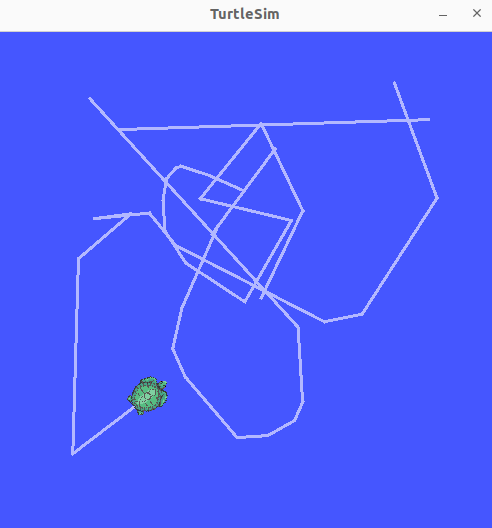

# Simülasyon Haftası Kurulum Notları

## Karşılaşılan Durumlar ve Çözümler
1. **GitHub Push Kimlik Doğrulama:** Terminal üzerinden `git push` yaparken hesap şifresi yerine GitHub Personal Access Token (PAT) oluşturuldu ve `git config --global credential.helper store` ile kaydedildi.
2. **Antigravity Kurulumu:** `.tar.gz` arşivi `/opt/antigravity` dizinine çıkartılarak çalıştırıldı ve Google hesabıyla oturum açıldı.
3. **Türkçe Sistem Dil Ayarı (Locale):** `locale` kontrolünde `tr_TR.UTF-8` görünüyordu; ROS 2 Humble uyumluluğu için `en_US.UTF-8` yerel ayarları tanımlandı.
4. **ROS 2 Humble & Turtlesim:** Kurulum tamamlandı, `turtlesim_node` ve `turtle_teleop_key` ile kaplumbağa kontrol edildi ve `/turtle1/pose` topic'inden canlı konum verisi okundu.

## Turtlesim Ekran Görüntüsü

